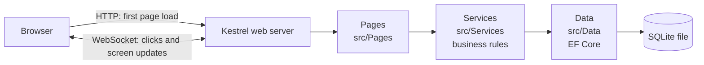

# Architecture

## The big picture

One Windows PC runs the app. Staff open it in a browser at `http://localhost`.
There is no separate front end: Blazor Server renders every screen on the server
and keeps a live connection (a WebSocket) to the browser to update it.

## Services by area
| Folder | Services |
|---|---|
| `Services/Security` | `AuthService`, `UserService`, `Permission`/`RolePermissions`, `CurrentUser` |
| `Services/Masters` | `SupplierService`, `CustomerService`, `VehicleService` |
| `Services/Ledger` | `LedgerPoster` (the accounting engine), `BusinessCalendar`, `BusinessDays`, `LedgerQueries`, `OpeningBalances` |
| `Services/Billing` | `InvoiceService`, `InvoiceMath` |
| `Services/Accounts` | `ReceiptService`, `PaymentService`, `LedgerMasterService`, `StatementService`, `DaySalesService`, `DashboardService` |
| `Services/Reports` | `ReportService` |
| `Services/Admin` | `BackupService`, `ActivityLogService` |
| `Services/Common` | `Money`, `Volume`, `IndianTime`, `Result`, `ReportTable`, `AmountInWords` |

Every service method starts with `await currentUser.RequireAsync(Permission.X)`, and every multi-step save
runs in one database transaction. PDFs are served by three endpoints in `Program.cs`, each with a permission check.

## Layers (top talks only to the one below)

| Layer | Folder | Job | Example (later) |
|---|---|---|---|
| Pages | `src/Pages` | Show data, collect input. No rules, no database. | Sales Invoice screen |
| Components | `src/Components` | Reusable UI parts: layout, menu, PDF layouts | Side menu |
| Services | `src/Services` | All business rules. Fully tested. | `InvoiceService.CreateInvoice(...)` |
| Data | `src/Data` | Tables as C# classes, database connection | `Vehicle`, `LedgerLine` |

**Why screens never touch the database:** every rule (amount = trip × rate, balanced
ledger, closed days locked) lives in one place, the service. Tests call the service
directly, so a rule is tested once and every screen gets it right. It also makes each
file small enough to explain.

## What happens on one request

1. The browser asks for `/`.
2. `Program.cs` runs the pipeline in order: error handler → security headers →
   404 page handler → HTTPS redirect → static files (CSS) → antiforgery check.
3. `App.razor` is the outer HTML page. `Routes.razor` matches the URL to a page's `@page "/"`.
4. The page renders inside `MainLayout` (top bar + side menu).
5. `blazor.web.js` opens the live connection. From now on, clicks travel over it
   and the server sends back only the parts of the screen that changed.

## Decisions so far

| Decision | Why |
|---|---|
| Every page interactive (`InteractiveServer` in `App.razor`) | Buttons and forms work everywhere; no per-page render-mode mistakes. Login page will be the exception in Session 6 (cookies need a normal page). |
| Menu defined as a list (`MenuItems.cs`) | One place to change; tested. Unbuilt modules show greyed out. |
| Unknown URLs → `/not-found` with status 404 | .NET 8 does not use the router's NotFound block for server-rendered pages. |
| Security headers incl. Content Security Policy | Browser loads scripts only from this app; page cannot be framed. |
| `AllowedHosts` = localhost only | Single-PC assumption (client question 8). Change if several PCs. |
| SQLite file via EF Core, created at startup by migrations | One-PC app, no database server to install. See `data-conventions.md`. |
| `IDbContextFactory<AppDbContext>` instead of one shared context | Blazor Server keeps a connection open for a long time; a fresh short-lived context per operation avoids stale data and threading errors. |
| WAL journal mode | Readers do not block the writer; safer after a crash. |
