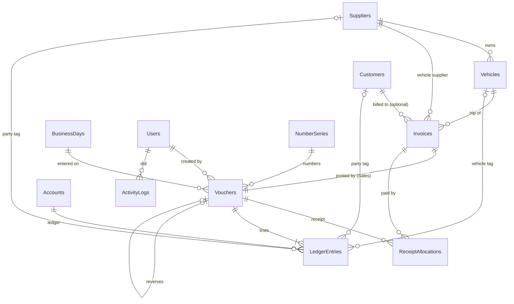

# Database

SQLite, one file. Created and upgraded by EF Core migrations in `src/Data/Migrations`.
Conventions (money in paise, volume in tenths, UTC times) are in `data-conventions.md`;
how postings work is in `ledger-design.md`.

| Table | Purpose | Protected by |
|---|---|---|
| Suppliers, Customers | Parties | Unique normalised name; checks on balance and status |
| Vehicles | Tankers; never physically deleted (codes never reused) | Unique code and number; capacity/rate checks |
| Users | Logins (password hash, role, security stamp) | Unique name |
| Accounts | Ledgers (8 system + expense ledgers) | Unique name; system ones locked in code |
| NumberSeries | Gapless numbering per series | Moved inside the save transaction |
| BusinessDays | Open/closed trading days and cash figures | Closed day refuses postings |
| Vouchers | Header of every posting | Amount > 0; one party; reversed at most once |
| LedgerEntries | The ledger lines | **Append-only triggers**; one-side check; unique posting sequence |
| Invoices | Trip invoices | Bill-to check; allocated ≤ amount |
| ReceiptAllocations | Which receipt paid which invoice | Deactivated, never deleted |
| ActivityLogs | Who did what, before/after | **Append-only triggers** |
