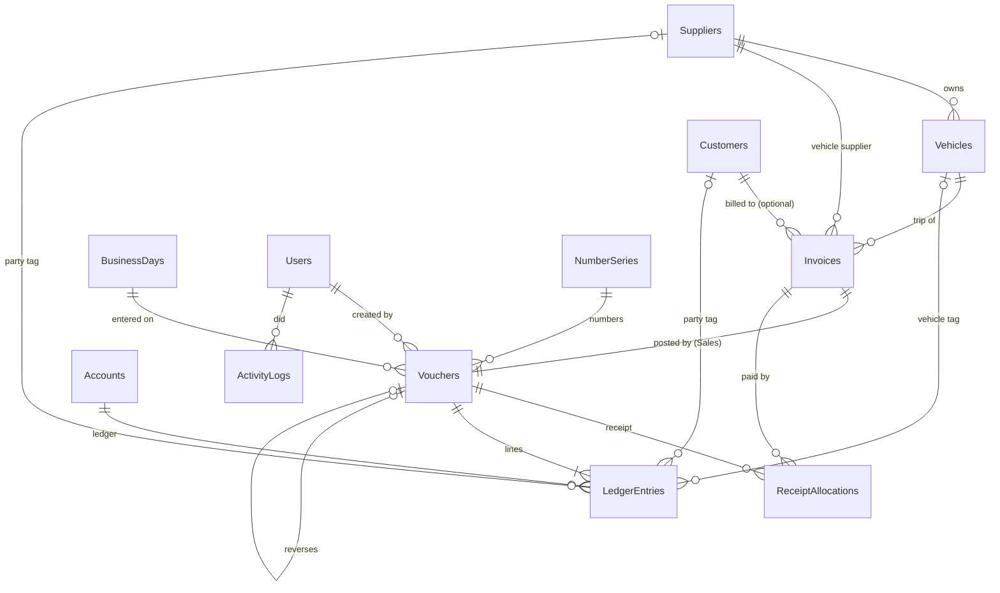

# Database

SQLite, one file. Created and upgraded by EF Core migrations in `src/Data/Migrations`.
Conventions (money in paise, volume in tenths, UTC times) are in `data-conventions.md`;
how postings work is in `ledger-design.md`.

| Table | Purpose | Protected by |
|---|---|---|
| Suppliers, Customers | Parties | Unique normalised name (among rows not deleted); checks on balance and status |
| Vehicles | Tankers; removed for good only 30 days after a delete (codes never reused) | Unique code and number; capacity/rate checks |
| Users | Logins (password hash, role, security stamp) | Unique name |
| Accounts | Ledgers (8 system + expense ledgers) | Unique name (among rows not deleted); system ones locked in code |
| SalesPersons | Invoice "Created by" names | Unique name (among rows not deleted); a name used on invoices is never removed for good |
| RetiredVehicleCodes | Codes of vehicles removed for good | Primary key = code, so it is never given out again |
| NumberSeries | Gapless numbering per series | Moved inside the save transaction |
| BusinessDays | Open/closed trading days and cash figures | Closed day refuses postings |
| Vouchers | Header of every posting | Amount > 0; one party; reversed at most once |
| LedgerEntries | The ledger lines | **Append-only triggers**; one-side check; unique posting sequence |
| Invoices | Trip invoices | Bill-to check; allocated ≤ amount |
| ReceiptAllocations | Which receipt paid which invoice | Deactivated, never deleted |
| ActivityLogs | Who did what, before/after | **Append-only triggers** |

## Soft delete (Recovery)
Suppliers, Customers, Vehicles, Accounts and SalesPersons have `DeletedAtUtc`, `DeletedByUserId` and
`DeletedBySalesPersonId` (the name chosen in "Deleted by" on the Sales login; empty = Admin).
A delete fills them in; EF Core leaves those rows out of every query (a global query filter; Vehicles use
`IsDeleted`). Recovery reads them with `IgnoreQueryFilters()` and can clear them again. Rows deleted more
than 30 days ago are removed for good by `RecoveryCleanupJob` (every 6 hours, and at start-up).

