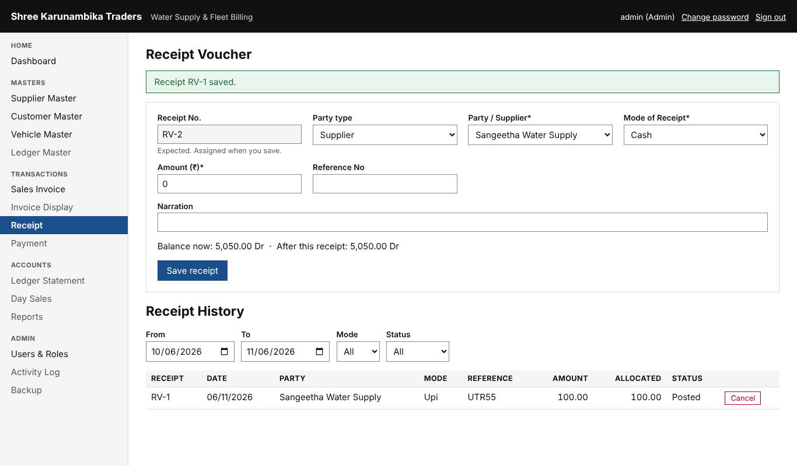

# User guide

Open **Water Billing** from the desktop (it opens `http://localhost:5080`). Sign in with your user name and
password. The first time, you must choose a new password (at least 8 characters, with a letter and a number).
You are signed out after 30 minutes without activity. The menu only shows what your role may use.

The business day runs **6:00 PM to 6:00 PM**. Anything entered from 6 PM belongs to the next date.

## Everyone
- **Dashboard**: this month's sales, today's sales/receipts/payments, outstanding, cash, a 6-month chart
  (click a bar to see that month's invoices) and the last 3 invoices. Change the month at the top right.
- **Vehicle Master / Supplier Master / Customer Master**: search and view.
- **Change password**: link at the top right.

## Dispatch Operator
**Make an invoice** — *Sales Invoice*
1. Choose the vehicle by code (A1) or by name; the supplier and rate fill in.
2. Trip is 1 unless more; for vehicles billed per kL, type the volume (one decimal).
3. Payment Mode: *Cash* if paid now, *Credit* otherwise. Check the total in Item Details, then **Save invoice**.
4. Use **Print** for the PDF. The number is given at save and never skipped.

**Take cash** — *Receipt*: choose the supplier, type the amount, **Save receipt**. The screen shows which
invoices it pays (oldest first) and the balance before and after. Operators take cash only.

## Billing Clerk
Everything the operator does, plus:
- **Bill a customer**: on Sales Invoice set *Bill To* → *A customer*.
- **Bank or UPI receipts**: a reference number is required.
- **Cancel an invoice**: open it (Invoice Display → number) → *Cancel invoice* with a reason. Invoices are
  never edited: cancel and make a new one. If a receipt already paid it, the receipt must be cancelled first
  (Accountant).
- **Statements**: *Ledger Statement* for a supplier, customer or vehicle, any period, with PDF.

## Accountant
- **Payment**: choose the ledger (e.g. Fuel Expense), who is paid, optional vehicle, mode, amount.
  For a refund to a supplier/customer choose *Refund / payout to …*. Paying more cash than is in hand needs a tick to confirm.
- **Cancel a receipt or payment**: in its history list, *Cancel* with a reason. A reversal is posted.
- **Ledger Master**: add expense ledgers; system ledgers cannot be changed.
- **Day Sales → close the day**: count the cash, type it in *Actual Cash Balance*. If it differs from the
  Closing Balance, give a reason (the difference is posted to Cash Over/Short). Days close in order.
  After closing, nothing more can be entered for that date; corrections go to the next day.
- **Reports**: 8 reports, filter by dates, supplier, vehicle; *Print PDF*.
- **Backup → Backup now** before any big change.

## Admin
Everything above, plus:
- **Users & Roles**: add users (temporary password), change role, reset password, deactivate (never delete).
  You cannot deactivate yourself or remove the last Admin.
- **Change a rate on one invoice**: the rate box is editable; a reason is required and it is logged.
- **Vehicle code**: may type a code instead of the proposed one (codes are never reused).
- **Starting numbers**: Ledger Master → set the first invoice number before the first invoice.
- **Activity Log**: who did what and when, with before/after values. Nobody can change it.

## Good habits
- Close every day. Copy `C:\ProgramData\WaterBilling\Backups` to a USB drive weekly.
- Never share passwords; each person has their own user so the log is meaningful.
