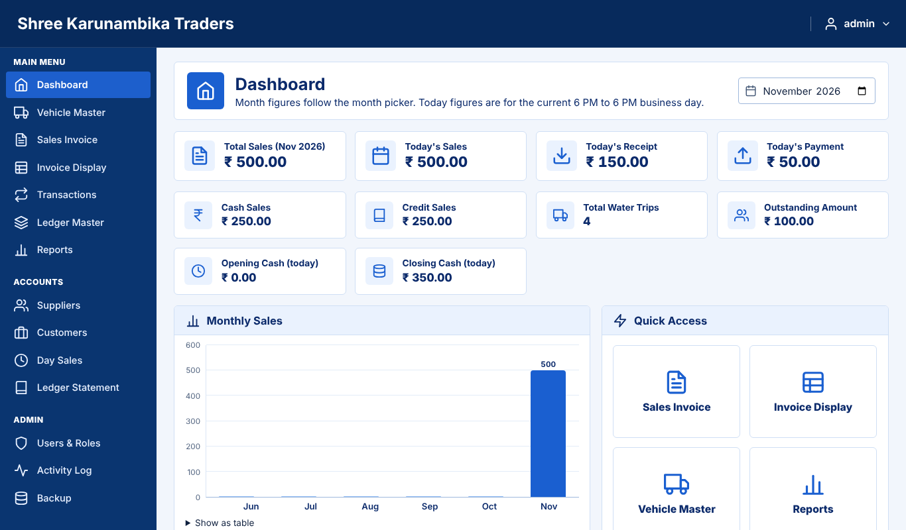
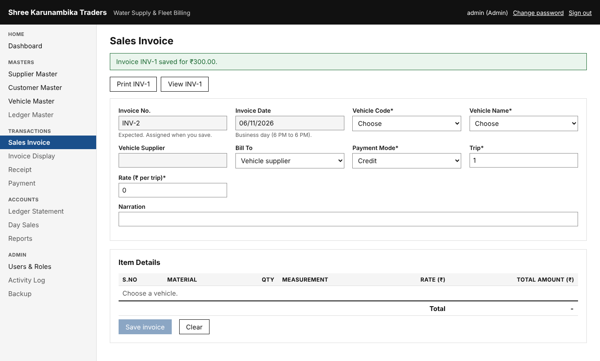
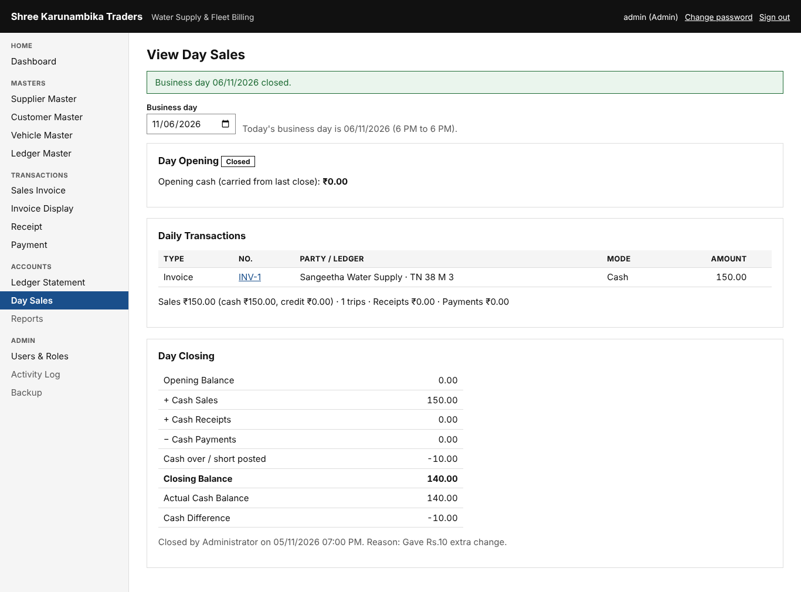

# User guide

Open **Water Billing** from the desktop (it opens `http://localhost:5080`). Sign in with your user name and
password. The first time, you must choose a new password (at least 4 characters: any letters, numbers or symbols, in any mix).
You are signed out after 30 minutes without activity. The menu only shows what your role may use.

The business day runs **6:00 PM to 6:00 PM**. Anything entered from 6 PM belongs to the next date.

## Who can do what
There are two logins: one **Admin** login and one shared **Sales** login. Only one active login per role is allowed.
Only Admin sees **Users & Roles**, **Sales Persons**, **Activity Log** and **Backup**; on the Sales login those items
are not in the menu and their addresses show "Page not found". The Sales login can do all the business work below.

Several sales people use the one Sales login, so each invoice asks **Created by**: the person picks their own name
(the list holds only the names the Admin added). Invoices made on the Admin login are always *Created by: Admin*.

| | Admin | Sales Person |
|---|---|---|
| Dashboard, Supplier, Customer, Vehicle and Ledger Masters | Yes | Yes |
| Sales Invoice, Invoice Display, cancel invoices, change a rate (with reason) | Yes | Yes |
| Receipt and Payment (Cash, Bank, UPI), cancel them | Yes | Yes |
| Ledger Statement, Day Sales and day closing, Reports | Yes | Yes |
| Users & Roles, Sales Persons, Activity Log, Backup | Yes | No (not shown anywhere) |

## Dashboard and masters
- **Dashboard**: this month's sales, today's sales/receipts/payments, outstanding, cash, a 6-month chart
  (click a bar to see that month's invoices) and the last 3 invoices. Change the month at the top right.
- **Supplier / Customer / Vehicle Master**: search, add, edit, set Inactive, delete a record with no history
  (a deleted record goes to **Recovery** for 30 days).
  A vehicle code (A1, A2 ...) is proposed and never reused; you may type another unused code.
- **Change password**: link at the top right.

## Outstanding (who has to pay)
Click the **Outstanding amount** box on the Dashboard. The Outstanding page lists every supplier and customer
whose balance is not zero, biggest first: *Dr* means they owe us, *Cr* means they paid in advance (or we owe them).
- The three boxes at the top show *Owed to us*, *Advances / we owe* and *Net outstanding* (the same figure as the Dashboard).
- **Show invoices** lists that party's unpaid invoices with billed, paid and due amounts. A line below them
  shows any opening balance or money received on account.
- **Statement** opens the party's full Ledger Statement.
- Filter by suppliers or customers, search by name, and print the supplier or customer outstanding PDF.

## Sales Invoice
1. On the Sales login, choose your name in **Created by** (on the Admin login it is fixed to *Admin*). It stays selected for your next invoice; change it when someone else takes over.
   If the list is empty, ask the Admin to add the names (Sales Persons page).
2. Choose the vehicle by code (A1) or by name; the supplier and rate fill in.
3. Trip is 1 unless more; for vehicles billed per kL, type the volume (one decimal).
4. Payment Mode: *Cash* if paid now, *Credit* otherwise. To bill a customer, set *Bill To* to *A customer*.
5. Changing the rate needs a reason and is logged. Check the total in Item Details, then **Save invoice**.
6. Use **Print** for the PDF. The number is given at save and never skipped.
7. **Cancel an invoice**: open it (Invoice Display, then the number), *Cancel invoice* with a reason. Invoices are
   never edited: cancel and make a new one. If a receipt already paid it, cancel the receipt first.

## Receipt and Payment
- **Receipt**: choose the supplier or customer, mode and amount, **Save receipt**. The screen shows which
  invoices it pays (oldest first) and the balance before and after. Bank and UPI need a reference number.
- **Payment**: choose the ledger (e.g. Fuel Expense), who is paid, optional vehicle, mode, amount.
  For a refund choose *Refund / payout to supplier* (or customer). Paying more cash than is in hand needs a tick to confirm.
- **Cancel a receipt or payment**: in its history list, *Cancel* with a reason. A reversal is posted.

## Ledgers, day close and reports
- **Ledger Master**: add expense ledgers; system ledgers cannot be changed. Admin can also set the first
  invoice number here before the first invoice.
- **Day Sales, close the day**: count the cash, type it in *Actual Cash Balance*. If it differs from the
  Closing Balance, give a reason (the difference is posted to Cash Over/Short). Days close in order.
  After closing, nothing more can be entered for that date; corrections go to the next day.
- **Ledger Statement**: supplier, customer, vehicle or ledger, any period, with PDF.
- **Reports**: 8 reports, filter by dates, supplier, vehicle; *Print PDF*.

## Recovery (both logins)
Nothing is removed straight away. A deleted supplier, customer, vehicle, ledger or sales person name is hidden
everywhere and listed on the **Recovery** page (after Backup on the Admin menu, at the bottom of the Sales menu),
with who deleted it and when. Admin and Sales can both press **Restore** to bring it back exactly as it was.
Every delete asks **Deleted by**: on the Sales login choose your name (the Admin's Sales Persons list); on the
Admin login it is fixed to *Admin*.
A restore is refused if the same name or vehicle number has been added again since.
After **30 days** the item is removed for good automatically. Every delete, restore and final removal is in the Activity Log.

## Admin only
- **Users & Roles**: the Admin login and the one Sales login. Create the Sales login once (temporary password,
  changed at first sign-in), reset its password, or deactivate it (never delete). A second active login of the
  same role is refused: deactivate the old one first. You cannot deactivate yourself or remove the last Admin.
- **Sales Persons**: the names in the invoice *Created by* list. *Add* a name; *Remove* takes it off the list.
  Invoices already made by that person keep their name. Adding the same name again brings the person back.
  The name "Admin" cannot be added: it is kept for invoices made on the Admin login.
- **Activity Log**: who did what and when, with before/after values. Nobody can change it.
- **Backup, Backup now** before any big change. One backup is also taken automatically each day.

## Good habits
- Close every day. Copy `C:\ProgramData\WaterBilling\Backups` to a USB drive weekly.
- Never share passwords; each person has their own user so the log is meaningful.
