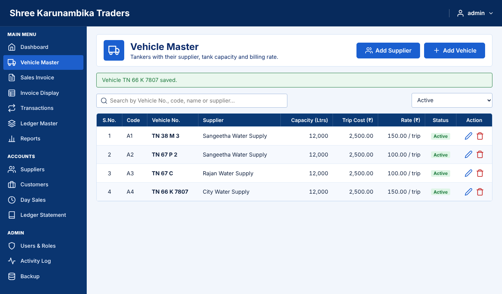
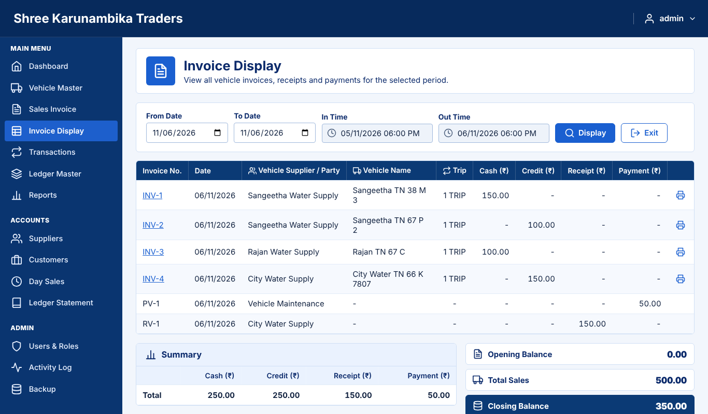
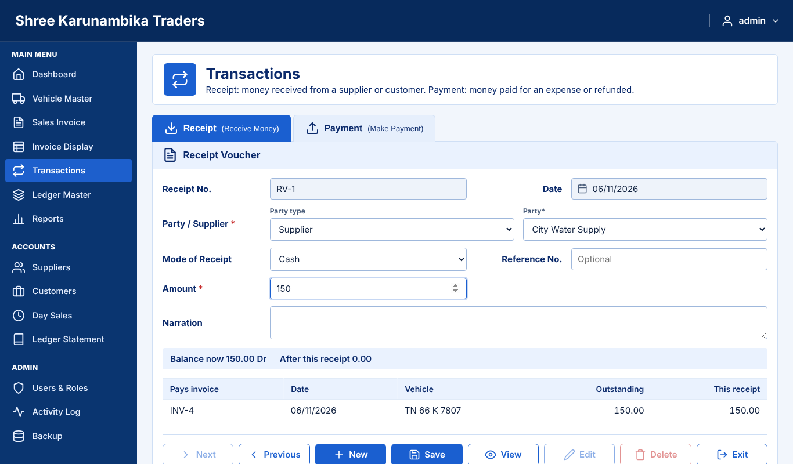
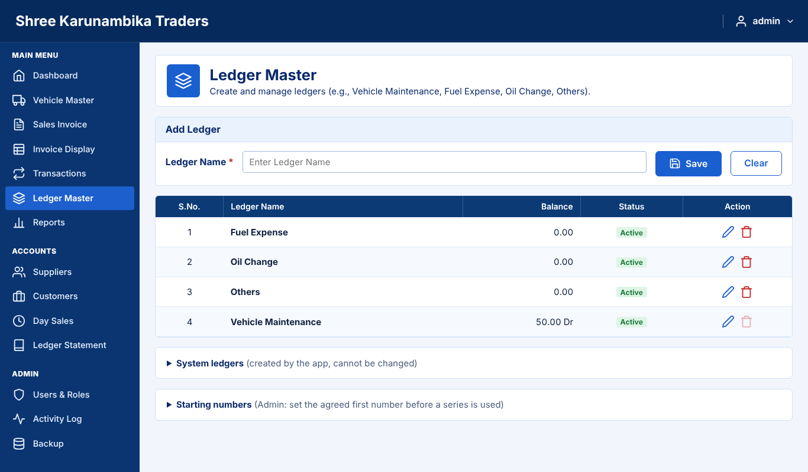

# User guide

Open **Water Billing** from the desktop (it opens `http://localhost:5080`). Sign in with your user name and
password. The first time, you must choose a new password (at least 8 characters, with a letter and a number).
You are signed out after 30 minutes without activity. The menu only shows what your role may use.

The business day runs **6:00 PM to 6:00 PM**. Anything entered from 6 PM belongs to the next date.

## Who can do what
| | Admin | Dispatch Operator, Billing Clerk, Accountant |
|---|---|---|
| Dashboard, Vehicle Master, Suppliers, Customers | Yes | Yes |
| Sales Invoice, Invoice Display, cancel invoices | Yes | Yes |
| Transactions (Receipt and Payment), Ledger Master | Yes | Yes |
| Day Sales and day closing, Ledger Statement, Reports | Yes | Yes |
| **Users & Roles, Activity Log, Backup** | Yes | No (not shown anywhere) |

## Dashboard
This month's sales, today's sales/receipts/payments, outstanding, cash, a 6-month chart
(click a bar to see that month's invoices), Quick Access and the last 3 invoices. Change the month at the top right.

## Vehicle Master, suppliers and customers
- **Vehicle Master** lists vehicles. **Add Supplier** and **Add Vehicle** are at the top right; the pencil edits,
  the bin deletes (only a vehicle with no transactions; otherwise set it Inactive).
- **Add Vehicle**: Vehicle No., Supplier, Trip Cost, Capacity, Status; under *Billing and Driver* the Rate
  (per trip or per kL) that invoices use. The vehicle code (A1, A2 ...) is proposed and never reused.
- **Add Supplier**: name, contact, phone, address, an Active tick box. An opening balance can only be given when adding.
- **Customers**: direct billing parties (e.g. Meena Constructions).

## Sales Invoice
1. Optionally pick the *Vehicle Supplier* to shorten the vehicle lists.
2. Choose the vehicle by *Vehicle No.* (code) or *Vehicle Name*; the supplier and rate fill in.
3. Trip is 1 unless more; for vehicles billed per kL, type the volume (one decimal).
4. *Payment Mode*: Cash if paid now, Credit otherwise. The yellow **Amount** box shows the total.
5. **Save**. Then **Print** for the PDF or **View** to open it. The number is given at save and never skipped.
6. To correct an invoice: **View** it and *Cancel* it with a reason, then make a new one. Changing the rate needs a reason and is logged.

## Invoice Display
Choose From and To dates and press **Display**: every invoice, receipt and payment with Cash, Credit, Receipt and
Payment columns, the totals, and Opening Balance, Total Sales and Closing Balance.

## Transactions (receipts and payments)
- **Receipt** tab: choose the party, mode and amount. The screen shows the balance before and after and which
  invoices it pays (oldest first). Bank and UPI need a reference number.
- **Payment** tab: choose the ledger (e.g. Vehicle Maintenance), who is paid, optional vehicle, mode, amount.
  For a refund choose *Refund / payout to supplier* (or customer). Paying more cash than is in hand needs a tick to confirm.
- **Previous / Next** show saved vouchers. **Delete** cancels the one on screen (a reason is required and a
  reversal is posted). Saved vouchers are never edited: cancel and enter again.

## Ledger Master
Type a ledger name and **Save**. The pencil renames or deactivates; the bin deletes a ledger that has no entries.
System ledgers (Cash in Hand, Water Sales and the others) are listed separately and cannot be changed.

## Day Sales and statements
- **Day Sales → close the day**: count the cash, type it in *Actual Cash Balance*. If it differs from the
  Closing Balance, give a reason (the difference is posted to Cash Over/Short). Days close in order.
  After closing, nothing more can be entered for that date; corrections go to the next day.
- **Ledger Statement**: supplier, customer, vehicle or ledger, any period, with PDF.
- **Reports**: 8 reports, filter by dates, supplier, vehicle; *Print PDF*.

## Admin only
- **Users & Roles**: add users (temporary password), change role, reset password, deactivate (never delete).
  You cannot deactivate yourself or remove the last Admin.
- **Activity Log**: who did what and when, with before/after values. Nobody can change it.
- **Backup → Backup now** before any big change. One backup is also taken automatically each day.
- **Starting numbers** (Ledger Master): set the first invoice number before the first invoice.

## Good habits
- Close every day. Copy `C:\ProgramData\WaterBilling\Backups` to a USB drive weekly.
- Never share passwords; each person has their own user so the log is meaningful.
